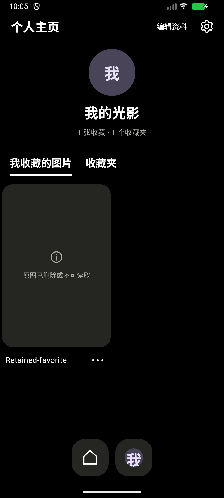
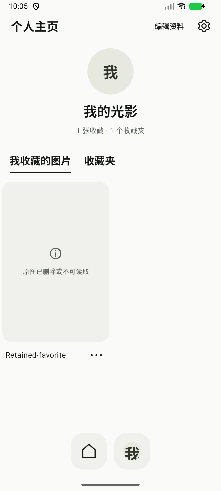

# Photerest

纯本地照片浏览、收藏与每日精选提醒工具。按你设置的时间，从本地相册或收藏挑选一张照片，用带图片预览的通知，让照片每天与你重逢。

**[下载 Photerest 1.3.3 APK](https://github.com/Max1426/Photerest/releases/download/v1.3.3/Photerest-1.3.3.apk)** · [全部版本](https://github.com/Max1426/Photerest/releases) · [反馈问题](https://github.com/Max1426/Photerest/issues)

这是 Photerest 的公开下载与反馈仓库。软件闭源，允许免费下载、安装和使用；本仓库不提供应用源码。软件使用条款见 [LICENSE](LICENSE)，开源组件的许可见 [第三方声明](THIRD_PARTY_NOTICES.md)。

## 功能

- 两列瀑布流按照片比例展示；“全部”直接浏览所有已授权的本地图片。
- 使用右上角“＋”关联指定相册，在标签间切换；各标签保留顺序与浏览位置。
- 在主页再次点击主页按钮，或在顶部下拉，随机刷新照片；从个人页返回主页保持原浏览状态。
- 大图查看、双指缩放、双击放大；读取文件信息及照片中已有的拍摄时间、位置记录。
- 独立于系统相册的收藏和收藏夹，支持本机昵称、头像。
- 系统分享、深色和浅色模式、可关闭的轻触反馈。
- 连续点击标题 7 次，发现彩色标题彩蛋。

## 每日精选照片通知

- 离线从全部已授权照片、指定相册或收藏图片随机推荐。
- 添加、修改、删除每日时间；每个时点一张，每日数量随时点数量变化。
- 本轮优先使用尚未推荐的照片，全部推荐后重新开始。
- 折叠通知显示缩略图，展开显示圆角大图；点击通知进入对应照片。
- 可关闭锁屏照片预览；测试通知不消耗正式推荐轮次。
- 通知声音和震动由系统通知设置管理。

## 安装

支持 Android 8.0（API 26）及以上版本。

1. 从上方链接下载 APK，在手机中打开并按系统提示允许安装。
2. 首次运行授权读取照片；部分授权时只显示你允许访问的图片。
3. 已安装旧版的用户可使用相同签名覆盖更新，保留本机资料、相册关联及收藏。请勿先卸载；卸载或清除应用数据会丢失这些整理记录。

当前 1.3.3（versionCode 8）为公开测试版本，沿用现有调试签名以兼容之前的安装包。APK 校验值及第三方许可文件随 Release 一同提供。测试范围详见 [验证记录](VERIFICATION.md)。

## 开启每日精选

1. 覆盖安装新版，打开“个人页 → 齿轮 → 每日精选”。
2. 开启每日精选，允许通知和照片访问。
3. Android 12 及以上点击“允许准时提醒”，在系统“闹钟和提醒”页面允许 Photerest，然后返回应用。
4. 选择推荐范围与每日时间，也可以先发送测试通知。

1.3.3 改用系统定时唤醒。正常返回桌面或熄屏，无需保持应用页面打开；每次触发先安排下一次提醒。重启、覆盖升级、系统时间或时区变化、获得准时提醒授权后会重新安排。

系统“强行停止”或禁止后台运行会影响提醒；强行停止后需要重新打开应用。未授权准时提醒、系统省电限制与过密时点仍可能造成延迟，建议时点至少间隔 15 分钟。并非所有设备或场景都保证绝对准点。

## 隐私与数据

- 纯本地使用，无联网注册、广告或云同步；本版应用不申请互联网权限。
- 不删除、移动或修改系统原照片。收藏保存照片引用，不复制原图；原图删除或访问权限失效后，收藏记录可能无法打开。
- 拍摄位置只读取照片中已有的 EXIF 记录，不获取手机当前位置。
- 分享时通过系统分享面板将所选图片交给接收应用；接收应用的数据处理遵循其自身规则。
- 本机资料和收藏没有云备份，请谨慎卸载或清除数据。

## 界面

以下为 1.2.1 的实际模拟器功能截图。截图中的资料和失效收藏是测试记录，正式使用不会自动添加示例照片。

 

## 更新与反馈

1.3.3 重点修复返回桌面、熄屏后定时提醒延迟，加入准时提醒授权入口、恢复调度与大图库优化；保留此前每日精选与圆角通知能力。[完整更新记录](CHANGELOG.md)

请通过 [Issues](https://github.com/Max1426/Photerest/issues) 反馈问题，并注明版本、手机型号、Android 版本和复现步骤。请勿上传私人照片或其他敏感信息。

Copyright © 2026 Max1426. Photerest 保留所有权利；第三方组件分别适用各自许可证。本项目与 Pinterest 无隶属或合作关系。
